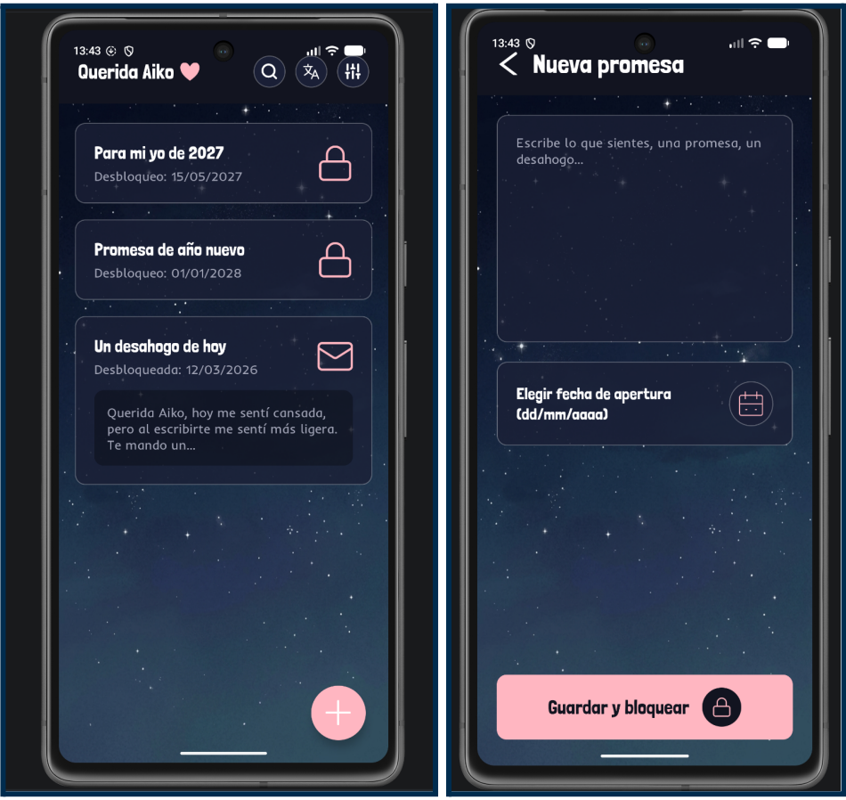
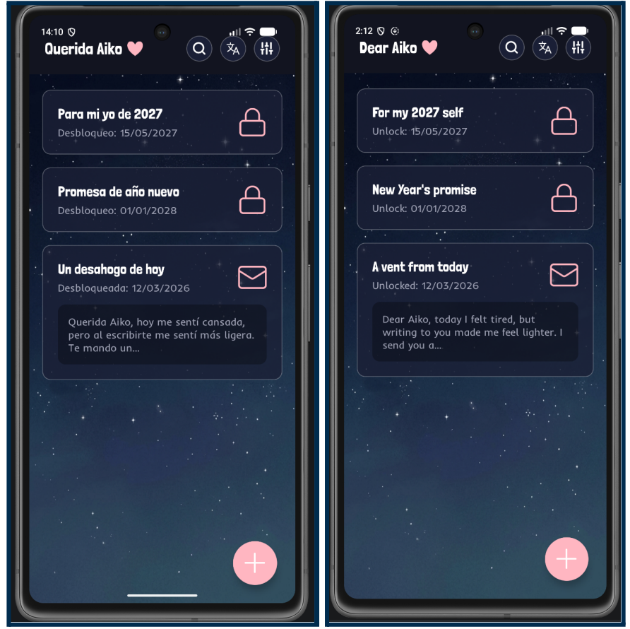
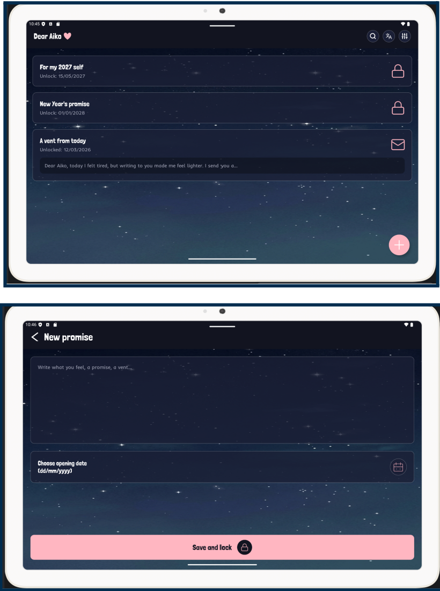

# Práctica 1 - Mi primera app Android: de la idea al proyecto con recursos
## Aplicación: Querida Aiko

**Autora:** Marta González González
**Curso:** 2º Desarrollo de Aplicaciones Multiplataforma (DAM)
**Módulo:** Programación Multimedia y Dispositivos Móviles (PMDM)
**Centro:** Instituto DAVANTE

---

> ### DOCUMENTACIÓN PRINCIPAL DEL PROYECTO (MEMORIA EN PDF)
> 
> **Importante:** Toda la documentación teórica, el análisis previo, los diagramas, las tablas comparativas y las capturas paso a paso de esta práctica se encuentran redactados en un documento **PDF** alojado dentro de este mismo repositorio.
> 
> * **Ruta del archivo en el repositorio:** `/docs/memoria.pdf`
> * **Enlace directo al documento:** **[Haz clic aquí para abrir la Memoria Técnica en PDF (docs/memoria.pdf)](docs/memoria.pdf)**

---

## 1. Introducción y descripción de la aplicación

En este repositorio recojo el proyecto completo de mi primera práctica de PMDM, donde he pasado desde la idea inicial hasta dejar la aplicación montada, estructurada y con todos sus recursos organizados en Android Studio. Más allá de programar la lógica interna, el objetivo de este trabajo ha sido entender cómo funciona el desarrollo nativo en Android utilizando **Java** y vistas en **XML**, controlar la estructura de carpetas del proyecto y gestionar de forma limpia todos los recursos visuales y de configuración sin dejar ningún valor escrito a mano en las pantallas

Para esta práctica he creado **"Querida Aiko"**, una aplicación pensada como un espacio de cartas y reflexiones nocturnas que funciona como una cápsula del tiempo emocional inspirada en el manga *Oyasumi Punpun* de Inio Asano

El funcionamiento de la aplicación se centra en ofrecer al usuario un diario personal, íntimo y seguro donde poder redactar promesas, desahogos o pensamientos (normalmente por la noche) y asignarles una fecha y una hora concretas de apertura en el futuro. Al guardar una nota, el contenido se queda bloqueado automáticamente en la aplicación, impidiendo su lectura hasta que el sistema verifique que ha llegado el momento exacto programado

Además, he planteado la aplicación teniendo en cuenta cómo se usa un móvil en el día a día:
* **Funcionamiento 100% local:** Para que la persona pueda escribir lo que siente en cualquier lugar (en el metro, de viaje o sin cobertura), la aplicación está diseñada para funcionar de forma local en el teléfono sin necesitar conexión a internet
* **Avisos en la fecha exacta:** En lugar de dejar procesos abiertos en segundo plano gastando batería para comprobar qué día es, el diseño se apoya en el gestor de alarmas de Android para lanzar una notificación justo el día en que una carta antigua pasa a estar desbloqueada
* **Interfaz nocturna y adaptable:** Todas las pantallas están diseñadas con tonos oscuros para no cansar la vista al escribir a oscuras, utilizando unidades adaptables y dos idiomas configurados (español e inglés) que cambian de forma automática según los ajustes del teléfono
---

## 2. Contenido de la Memoria Técnica (`/docs/memoria.pdf`)

En el documento PDF incluido en la carpeta `/docs/memoria.pdf` se desarrolla al completo cada apartado exigido en la actividad:

1. **Introducción:** Explicación general de la práctica y del concepto de *Querida Aiko*.
2. **Parte A — Análisis del desarrollo móvil:**
   * *Ventajas e inconvenientes:* Análisis de la disponibilidad del teléfono frente a un PC y estudio de 7 limitaciones aplicadas directamente a mi app (consumo de batería con alarmas, tamaño de pantalla, variedad de dispositivos y resoluciones, desplazamiento con el teclado virtual, memoria RAM y almacenamiento, conectividad local y permisos de notificaciones).
   * *Elección tecnológica:* Tabla comparativa entre desarrollo Nativo, Híbrido y Multiplataforma (lenguajes, rendimiento, acceso al hardware, coste/tiempo, experiencia de usuario y frameworks) y justificación de por qué he elegido Android nativo en Java y XML.
   * *Ciclo de vida de una Activity:* Diagrama propio dibujado a mano y análisis de qué ocurre en los métodos `onCreate()`, `onStart()`, `onResume()`, `onPause()`, `onStop()`, `onDestroy()` y `onSaveInstanceState()` cuando el usuario recibe una llamada a mitad de una carta, gira el móvil o pulsa el botón atrás.
3. **Parte B — Especificación de la app:**
   * *Idea, público objetivo y objetivos medibles:* Definición del público (jóvenes de 15 a 25 años) y 4 objetivos medibles de tiempo de redacción, precisión de avisos, velocidad de carga y retención.
   * *Requisitos funcionales y no funcionales:* Definición de 7 requisitos funcionales priorizados (`RF-01` a `RF-07`) y 5 requisitos no funcionales verificables (`RNF-01` a `RNF-05`) de privacidad, fiabilidad con autoguardado, usabilidad visual en `sp`, rendimiento en menos de 2 segundos y compatibilidad con Android 7.0.
   * *Casos de uso:* Diagrama completo con actores (*Usuario Lector* y *Sistema Android*) y fichas detalladas de `CU-01 Desbloquear nota temporal` y `CU-02 Escribir carta nocturna`.
4. **Parte C — Entorno de desarrollo:** Configuración del proyecto, explicación de los archivos y carpetas generados por Android Studio, conexión entre Java y XML mediante el inflado de vistas y pruebas en dos emuladores.
5. **Parte D — Recursos de la aplicación:** Bocetos previos en Figma, textos e internacionalización, imágenes vectoriales frente a mapas de bits, icono adaptativo en `mipmap` y paleta de colores, fuentes y estilos propios.
6. **Conclusión personal y Bibliografía:** Valoración de lo aprendido, dificultades al descargar los emuladores y cuadrar los layouts de Figma, y listado de referencias oficiales.

---

## 3. Configuración técnica y estructura del proyecto

He creado el proyecto en Android Studio partiendo de la plantilla **Empty Views Activity** con los siguientes datos de configuración:

| Parámetro | Valor configurado en el proyecto |
| :--- | :--- |
| **Nombre del proyecto** | `PMDM_P1_MartaGonzalez` |
| **Nombre del paquete** | `es.medac.martagonzalez.app` |
| **Lenguaje** | Java (lógica) y XML (diseño de vistas) |
| **Minimum SDK** | API 24 — Android 7.0 (Nougat), elegida para asegurar una alta compatibilidad con móviles antiguos y actuales |
| **Pantallas (Activities)** | `MainActivity.java` y `NuevaPromesaActivity.java` |

### Estructura de archivos del repositorio

He organizado el proyecto separando toda la lógica en Java de la parte visual en XML:

* **`docs/`:** Carpeta donde está guardada la memoria técnica en formato PDF (`docs/memoria.pdf`) junto con las capturas del proyecto.
* **`app/src/main/AndroidManifest.xml`:** Archivo de configuración central donde le indico a Android el nombre de la aplicación, el tema visual, el icono adaptativo que utiliza y las pantallas (`MainActivity` y `NuevaPromesaActivity`).
* **`app/src/main/java/es/medac/martagonzalez/app/`:** Carpeta de código fuente en Java donde están `MainActivity.java` y `NuevaPromesaActivity.java`. Ambas clases se conectan con sus respectivos diseños XML mediante el método `setContentView()` dentro de `onCreate()`, que se encarga de inflar el diseño en memoria, y `findViewById()` para enlazar los componentes visuales por su ID.
* **`app/src/main/res/layout/`:** Contiene los archivos `activity_main.xml` (pantalla principal con el listado de cartas bloqueadas y desbloqueadas) y `activity_nueva_promesa.xml` (pantalla de redacción y elección de fecha de apertura).
* **`app/src/main/res/drawable/`:** Incluye el fondo estrellado en mapa de bits (`fondo_noche.png`), los fondos personalizados de tarjetas y botones (`bg_boton_rosa.xml`, `bg_desahogo.xml`, `bg_icono_oscuro.xml`, `bg_icono_superior.xml`, `fondo_tarjeta_transparente.xml`) y todos los iconos en formato vectorial XML (`ic_candado.xml`, `ic_candado_promesa.xml`, `ic_carta.xml`, `ic_calendario.xml`, `ic_lupa.xml`, `ic_traductor.xml`, `ic_ajustes.xml`, `ic_flecha.xml`, `ic_mas.xml`, `ic_corazon_titulo.xml`).
* **`app/src/main/res/mipmap-*/`:** Carpetas (`mdpi`, `hdpi`, `xhdpi`, `xxhdpi`, `xxxhdpi` y `anydpi-v26`) donde se guardan todas las resoluciones del icono adaptativo de la app para que no se vea borroso en ningún dispositivo.
* **`app/src/main/res/font/`:** Contiene las fuentes descargadas `londrina_solid.ttf` e `inder_regular.ttf` junto a su configuración en `font.xml`.
* **`app/src/main/res/values/` y `values-en/`:** Carpetas donde se centralizan todos los textos en español (`strings.xml`), su traducción al inglés (`values-en/strings.xml`), los colores (`colors.xml`), los estilos (`styles.xml`), las medidas (`dimens.xml`) y los temas (`themes.xml`).
* **`app/src/main/res/xml/` y `keepRules/`:** Archivos generados por Android Studio para copias de seguridad (`backup_rules.xml`, `data_extraction_rules.xml`) y reglas de compresión (`rules.keep`).
* **`build.gradle` y `settings.gradle`:** Scripts de Gradle encargados de compilar el proyecto, definir las versiones de Android y gestionar las dependencias.

---

## 4. Organización de los recursos de la aplicación (Parte D)

Antes de pasar las pantallas a Android Studio, diseñé el boceto completo en Figma para tener clara la distribución visual. A la hora de maquetarlo en XML, he organizado todos los recursos cumpliendo cada requisito:

| Recurso | Archivo / Carpeta | Detalles de la implementación en Querida Aiko |
| :--- | :--- | :--- |
| **Textos y parámetros** | `res/values/strings.xml` | He creado 12 cadenas de texto para no dejar ningún texto escrito a mano en los layouts. En las fechas de apertura he usado la estructura con parámetro `Desbloqueo: %1$s` acompañada de `tools:text` en el editor. |
| **Internacionalización** | `res/values-en/strings.xml` | Carpeta secundaria con todos los textos traducidos al inglés (*Dear Aiko*, *New promise*, *Save and lock*, etc.). Android detecta el idioma del móvil y cambia todos los textos automáticamente. |
| **Imágenes (Bitmap y Vector)** | `res/drawable/` | He usado un mapa de bits (`fondo_noche.png`) para el fondo de estrellas porque tiene muchos detalles y degradados, y vectores XML para todos los iconos pequeños (candado, sobre, lupa, calendario) porque pesan muy poco y no pierden calidad al escalar. |
| **Icono adaptativo** | `res/mipmap-*/` | Creado con la herramienta *Image Asset* de Android Studio y enlazado en el `AndroidManifest.xml` para que se adapte a iconos redondos o cuadrados según el móvil. |
| **Paleta de colores** | `res/values/colors.xml` | Paleta de 6 colores con nombres funcionales (`color_fondo_principal`, `color_fondo_tarjetas`, `color_fondo_desahogo`, `color_acento_interfaz`, `color_texto_primario` y `color_texto_secundario`). Los tonos oscuros reducen la fatiga visual de noche y ahorran batería en pantallas OLED, mientras que el rosa resalta los botones. |
| **Estilos, fuentes y tema** | `res/values/styles.xml` y `themes.xml` | He combinado la fuente *Londrina Solid* para títulos y la fuente *Inder* para lecturas largas creando los estilos reutilizables `EstiloTituloAiko` y `EstiloTextoSecundario`, aplicando `dp` para tamaños/márgenes y `sp` para textos. |

---

## 5. Dispositivos virtuales (AVD) y capturas de pantalla

Para comprobar cómo se adapta el diseño en pantallas de distintos tamaños y densidades, he configurado dos emuladores en el *Device Manager* de Android Studio (un móvil y una tablet):

| Tipo de Dispositivo | Modelo (AVD) | Resolución | Densidad de Píxeles | Versión de API |
| :--- | :--- | :--- | :--- | :--- |
| **Móvil** | Pixel 7 | 1080 x 2400 px | 420 dpi (xxhdpi) | API 37.2 |
| **Tablet** | Pixel Tablet | 2560 x 1600 px | 320 dpi (xhdpi) | API 35 |

### Capturas de la interfaz

**1. Diseño en ejecución dentro del emulador móvil (Pantalla principal y Nueva promesa):**  

**2. Demostración de internacionalización en Español e Inglés (`values` y `values-en`):**  

**3. Adaptación de las pantallas en el emulador de Tablet (Pixel Tablet):**  

*(Nota: Todas las capturas adicionales del proceso, incluyendo el boceto en Figma, el icono en el lanzador y la primera prueba de arranque en los emuladores, están disponibles dentro del archivo [`docs/memoria.pdf`](docs/memoria.pdf))*.

---

## 6. Pasos para abrir y ejecutar el proyecto

Si quieres clonar este repositorio y probar la aplicación en tu ordenador con Android Studio, sigue estos pasos:

1. **Clonar el repositorio:**  
   Abre una terminal en tu ordenador y descarga el proyecto ejecutando:  
   `git clone https://github.com/mgg06/pmdm_p1_martagonzalez.git`
2. **Abrir en Android Studio:**  
   Abre Android Studio, entra en el menú `File > Open` y selecciona la carpeta del proyecto recién clonado (`pmdm_p1_martagonzalez`).
3. **Sincronizar archivos de Gradle:**  
   Espera unos segundos a que Android Studio descargue las dependencias y termine de cargar Gradle. Si no se inicia solo, pulsa en `File > Sync Project with Gradle Files`.
4. **Seleccionar el emulador (AVD):**  
   En el desplegable de dispositivos de la barra superior, elige un emulador configurado con Android 7.0 (API 24) o superior, como el Pixel 7 o la Pixel Tablet.
5. **Compilar y ejecutar:**  
   Pulsa el botón verde **Run 'app'** (`Shift + F10`) para que la aplicación se instale y se abra automáticamente en el emulador.
6. **Comprobar la traducción al inglés:**  
   Para ver el cambio automático de idioma, entra en los ajustes del propio emulador (`Settings > System > Languages`), cambia el idioma del teléfono a **English** y vuelve a abrir la aplicación para ver cómo carga todos los textos en inglés (*Dear Aiko*).
